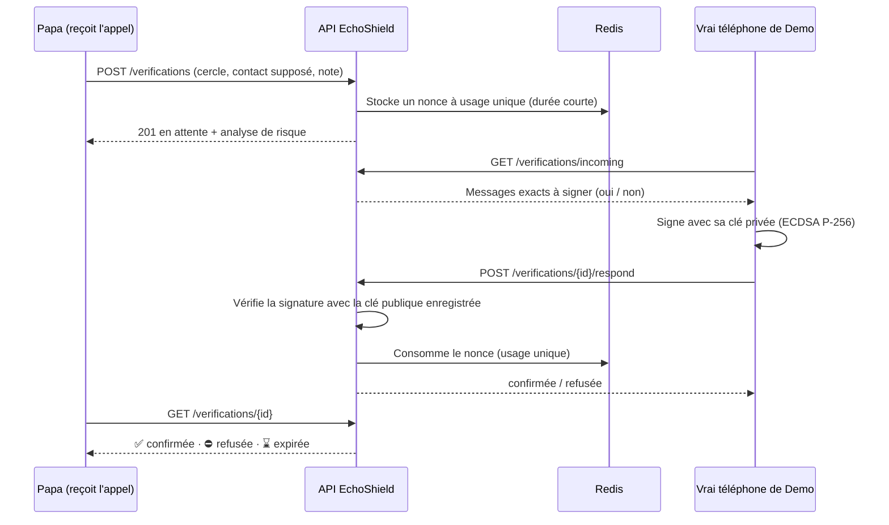
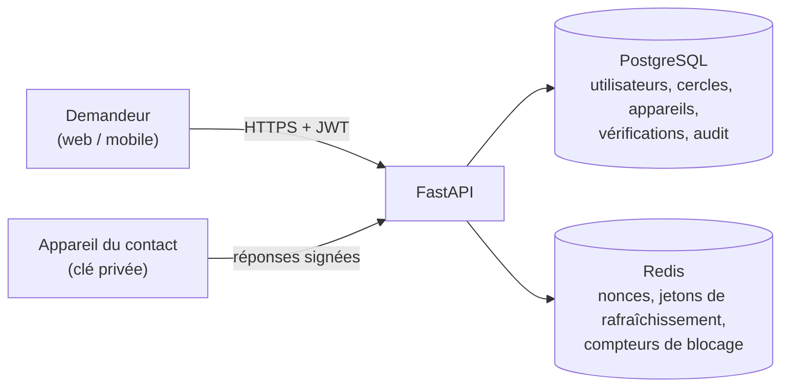

# EchoShield

**Vérifier la demande, pas la voix.**

Quelques secondes d'audio suffisent aujourd'hui pour cloner une voix. EchoShield protège les familles et les entreprises contre les arnaques au clonage vocal avec une idée simple : plutôt que de chercher à détecter les deepfakes — une course que les défenseurs perdent sans cesse — il vérifie l'**authenticité de la demande** par des canaux qu'un escroc ne peut pas imiter.

🇬🇧 [English version](README.md)


---

## Le problème

Votre téléphone sonne. C'est exactement la voix de votre fils, de votre père ou de votre PDG. Il y a une urgence, il faut envoyer de l'argent tout de suite, et surtout n'en parler à personne.

Toutes les arnaques au clonage vocal suivent ce schéma : **une voix familière + l'urgence + l'argent + le secret**. On ne peut plus se fier à la voix. On peut encore vérifier la demande.

## Comment fonctionne EchoShield

EchoShield donne à une famille ou à une entreprise trois moyens indépendants de vérifier un appel suspect :

| Couche | Ce qu'elle fait | Pourquoi l'escroc échoue |
| --- | --- | --- |
| 📱 **Vérification hors canal** | Le téléphone du vrai contact reçoit un défi et signe « Oui, c'est moi » ou « Non, ce n'est pas moi ». | Cloner une voix ne donne pas accès au téléphone de la victime ni à sa clé privée. |
| 🔑 **Code secret familial** | Les membres conviennent d'une phrase secrète ; l'appelant doit la donner. | L'escroc ne la connaît pas, et il est bloqué après 3 erreurs. |
| ⚠️ **Moteur de risque** | Analyse le texte de la demande (FR / EN / AR) à la recherche de signaux d'arnaque. | Urgence, argent, secret, cartes cadeaux, nouveau RIB… sont signalés avec leurs raisons. |

### Déroulement d'une vérification



## Architecture



## Modèle de sécurité

Le projet a été construit autour d'une question : *comment un attaquant essaierait-il de le contourner ?* Chaque règle ci-dessous est couverte par un test automatisé.

| Menace | Protection |
| --- | --- |
| Rejouer un « Oui » intercepté | Chaque défi est un nonce à usage unique, stocké dans Redis et consommé à la première réponse valide. |
| Copier une signature sur une autre demande | Le message signé lie l'identifiant de la demande, le nonce **et** la décision. |
| Transformer un « Non » en « Oui » | La décision fait partie du message signé. |
| Signer avec la clé d'un attaquant | Les signatures sont vérifiées avec la clé publique enregistrée pour cet appareil. |
| Utiliser un téléphone volé et révoqué | Les appareils révoqués sont refusés avant toute vérification de signature. |
| Pirater un compte et ajouter un nouveau téléphone | Un nouvel appareil attend 24 h avant de pouvoir confirmer, même après la révocation de tous les autres. |
| Entrer dans un cercle pour valider sa propre arnaque | Un nouveau membre ne peut rien confirmer pendant 24 h (dire « Non » reste toujours possible). |
| Deviner le code familial par force brute | 3 erreurs bloquent tout le cercle pendant 15 minutes. |
| Changer le code familial en douce | Un nouveau code n'est actif qu'après 24 h ; l'ancien reste valable entre-temps. |
| Récupérer un téléphone perdu trop facilement | Un nouveau téléphone n'est activé en avance qu'avec **2 validations** de membres de confiance, chacune **signée** par leur propre téléphone. |
| Aucune réponse | Le silence n'est jamais une confirmation : la demande expire. |
| Découverte des comptes existants | La connexion renvoie le même message, dans le même temps, pour un e-mail inconnu ou un mauvais mot de passe. |
| Vol d'un jeton de rafraîchissement | Les jetons de rafraîchissement sont à usage unique (rotation) et révoqués à la déconnexion. |
| Fuite de la base de données | Mots de passe et codes familiaux sont hachés avec Argon2 ; seules les clés publiques sont stockées. |

## Stack technique

| Couche | Technologies |
| --- | --- |
| API | Python 3.11, FastAPI, Pydantic v2 |
| Données | PostgreSQL 16, SQLAlchemy 2 (async), migrations Alembic |
| Cache et état éphémère | Redis 7 (nonces, jetons de rafraîchissement, blocages) |
| Sécurité | Argon2 (argon2-cffi), JWT (PyJWT), signatures ECDSA P-256 (cryptography) |
| Tests | pytest + httpx — 72 tests d'intégration et unitaires |
| Infrastructure | Docker, Docker Compose |

## Démarrage

Prérequis : [Docker Desktop](https://www.docker.com/products/docker-desktop/) et Git.

```bash
git clone https://github.com/houssembalbali1234/echoshield.git
cd echoshield
cp .env.example .env        # Windows (cmd) : copy .env.example .env
docker compose up -d --build
docker compose exec api alembic upgrade head
```

L'API tourne :

- Documentation interactive : http://localhost:8000/docs
- État de santé : http://localhost:8000/api/health

> Avant tout déploiement réel, remplacez `SECRET_KEY` dans `.env` par une longue valeur aléatoire :
> `docker compose exec api python -c "import secrets; print(secrets.token_urlsafe(64))"`

### Lancer les tests

```bash
docker compose exec api pytest -v
```

### Simuler un téléphone

Il n'y a pas encore d'application mobile : un petit simulateur génère les paires de clés et signe les défis depuis le terminal.

```bash
# Créer la paire de clés d'un appareil et afficher le Body d'enregistrement
docker compose exec api python tools/device_sim.py new demo-phone --label "Telephone de Demo"

# Signer un défi renvoyé par GET /api/verifications/incoming
docker compose exec api python tools/device_sim.py sign demo-phone "echoshield:v1:<id>:<nonce>:confirm"
```

Les clés privées sont enregistrées dans `backend/tools/keys/`, ignoré par Git.

## Aperçu de l'API

| Domaine | Routes |
| --- | --- |
| Authentification | `POST /api/auth/register` · `login` · `refresh` · `logout` · `GET /api/auth/me` |
| Cercles | `POST/GET /api/circles` · `GET /api/circles/{id}` · `POST /api/circles/{id}/invitations` · `POST /api/invitations/accept` · `DELETE /api/circles/{id}/members/{user_id}` |
| Appareils | `POST/GET /api/devices` · `DELETE /api/devices/{id}` · `POST /api/devices/{id}/approvals` |
| Vérifications | `POST/GET /api/verifications` · `GET /api/verifications/incoming` · `GET /api/verifications/{id}` · `POST /api/verifications/{id}/respond` |
| Code familial | `PUT/GET /api/circles/{id}/secret-code` · `POST /api/circles/{id}/secret-code/check` |
| Risque | `POST /api/risk/analyze` |

Les schémas complets sont disponibles dans la documentation interactive, sur `/docs`.

## Choix de conception

**Pourquoi vérifier la demande plutôt que détecter les deepfakes ?**
Les détecteurs de deepfakes audio se généralisent mal aux nouveaux générateurs de voix et aux conditions réelles d'un appel téléphonique. Une signature cryptographique venant du téléphone de la vraie personne ne perd pas en efficacité quand le clonage vocal progresse.

**Pourquoi des signatures ECDSA plutôt qu'un simple bouton « Oui » ?**
Un bouton prouve seulement que *quelqu'un* est connecté au compte. Une signature prouve que la réponse vient d'un appareil physique précis, dont la clé privée ne sort jamais — le même principe que les passkeys.

**Pourquoi des règles déterministes pour le moteur de risque, et pas un LLM ?**
Les règles sont prévisibles, explicables (chaque alerte indique les mots exacts qui l'ont déclenchée), testables, gratuites et fonctionnent hors ligne. Un LLM pourra plus tard aider à *extraire* des informations, mais il ne décidera jamais seul du niveau de risque.

**Pourquoi autant de délais de 24 heures ?**
La plupart des prises de contrôle de compte sont remarquées en quelques heures. Retarder chaque changement sensible (nouvel appareil, nouveau membre, nouveau code familial) laisse au vrai propriétaire le temps de réagir, tandis que la récupération reste possible grâce aux validations de proches de confiance.

**Pourquoi tolérer quelques secondes de décalage d'horloge ?**
La suite de tests a fait apparaître des échecs aléatoires dus à la dérive d'horloge de la machine virtuelle Docker/WSL2. La validation des JWT utilise désormais une marge de 10 s, et les dates « actif immédiatement » sont antidatées de 30 s. Les délais de 24 h ne sont pas affectés.

## Structure du projet

```
echoshield/
├── docker-compose.yml
├── .env.example
└── backend/
    ├── app/
    │   ├── api/          # routes FastAPI
    │   ├── core/         # configuration, sécurité, crypto, Redis, horloge
    │   ├── db/           # base et session SQLAlchemy
    │   ├── models/       # modèles de la base de données
    │   ├── schemas/      # modèles Pydantic des requêtes et réponses
    │   └── services/     # logique métier (moteur de risque)
    ├── migrations/       # migrations Alembic
    ├── tests/            # suite pytest (72 tests)
    └── tools/            # simulateur de téléphone
```

## Feuille de route

- [x] Authentification, cercles et invitations
- [x] Enregistrement d'appareils par clé publique, révocation, délai de 24 h
- [x] Vérification hors canal signée, défis à usage unique, expiration
- [x] Moteur de risque (français, anglais, arabe)
- [x] Code secret familial avec blocage
- [x] Récupération d'un téléphone par 2 validations signées
- [ ] Application web Next.js (PWA)
- [ ] Notifications Web Push pour faire sonner le téléphone du contact
- [ ] Mode Entreprise : workflow de validation des virements (paiements simulés)
- [ ] Signal audio anti-spoofing optionnel, avec une évaluation honnête
- [ ] Intégration continue avec GitHub Actions

## Avertissement

EchoShield est un projet de portfolio. Il documente ses choix de confidentialité et de sécurité, mais il n'a pas été audité et ne revendique aucune conformité juridique (RGPD ou autre). Ne vous en servez pas pour protéger de vrais fonds.