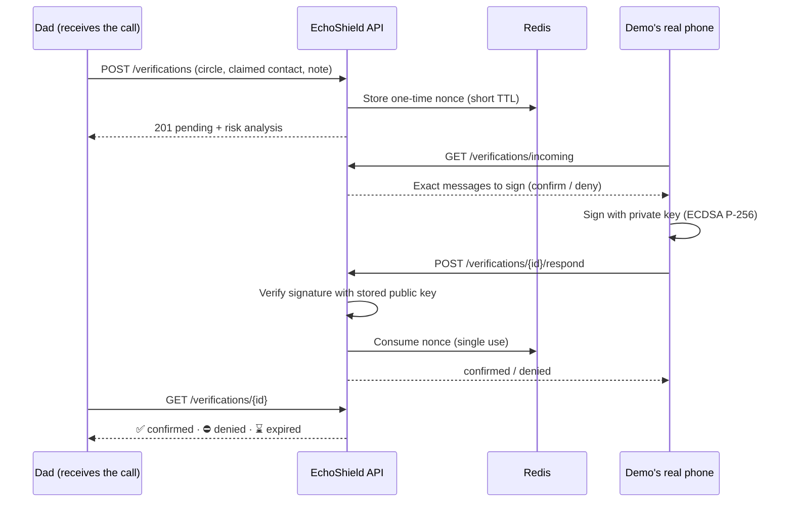
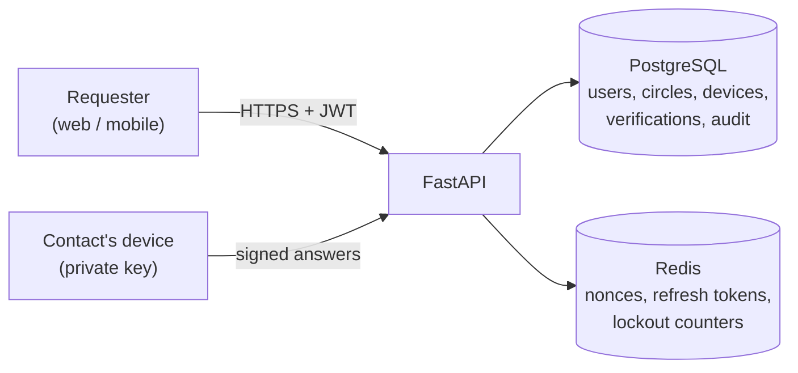

# EchoShield

**Verify the request, not the voice.**

A few seconds of audio are now enough to clone someone's voice. EchoShield protects families and businesses against AI voice-cloning scams with a simple idea: instead of trying to detect deepfakes — a race defenders keep losing — it verifies the **authenticity of the request** through channels a scammer cannot fake.

🇫🇷 [Version française](README.fr.md)


---

## The problem

Your phone rings. It sounds exactly like your son, your father or your CEO. There is an emergency, money must be sent now, and please don't tell anyone.

Every voice-cloning scam follows this pattern: **a familiar voice + urgency + money + secrecy**. The voice can no longer be trusted. The request can still be verified.

## How EchoShield works

EchoShield gives a family or a company three independent ways to check a suspicious call:

| Layer | What it does | Why a scammer fails |
| --- | --- | --- |
| 📱 **Out-of-band verification** | The real contact's phone receives a challenge and signs "Yes, it's me" or "No, it's not me". | Cloning a voice does not give access to the victim's phone and its private key. |
| 🔑 **Family secret code** | Members agree on a passphrase; the caller must say it. | The scammer doesn't know it, and gets locked out after 3 wrong attempts. |
| ⚠️ **Risk engine** | Analyses the request text (FR / EN / AR) for scam signals. | Urgency, money, secrecy, gift cards, new bank details… are flagged with explanations. |

### Verification flow



## Architecture



## Security model

The project was built around one question: *how would an attacker try to break this?* Every rule below is covered by an automated test.

| Threat | Protection |
| --- | --- |
| Replaying an intercepted "Yes" | Each challenge is a single-use nonce stored in Redis and consumed on first valid answer. |
| Copying a signature to another request | The signed message binds request ID, nonce **and** decision. |
| Turning a "No" into a "Yes" | The decision is part of the signed message. |
| Signing with an attacker's key | Signatures are verified against the public key registered for that device. |
| Using a stolen, revoked phone | Revoked devices are rejected before any signature check. |
| Taking over an account and adding a new phone | New devices wait 24 h before they can confirm — even after revoking all others. |
| Joining a circle to approve your own scam | New members cannot confirm anything for 24 h ("No" is always allowed). |
| Brute-forcing the family code | 3 wrong attempts lock the whole circle for 15 minutes. |
| Silent changes to the family code | A new code only becomes active after 24 h; the old one keeps working meanwhile. |
| Recovering a lost phone too easily | A new phone can be activated early only with **2 approvals** from trusted members, each **signed** by their own phone. |
| No answer at all | Silence is never a confirmation: the request expires. |
| Account enumeration | Login returns the same message and timing for unknown e-mails and wrong passwords. |
| Stolen refresh token | Refresh tokens are single-use (rotation) and revoked on logout. |
| Database leak | Passwords and family codes are hashed with Argon2; only public keys are stored. |

## Tech stack

| Layer | Technologies |
| --- | --- |
| API | Python 3.11, FastAPI, Pydantic v2 |
| Data | PostgreSQL 16, SQLAlchemy 2 (async), Alembic migrations |
| Cache & ephemeral state | Redis 7 (nonces, refresh tokens, lockouts) |
| Security | Argon2 (argon2-cffi), JWT (PyJWT), ECDSA P-256 signatures (cryptography) |
| Tests | pytest + httpx — 72 integration and unit tests |
| Infrastructure | Docker, Docker Compose |

## Getting started

Requirements: [Docker Desktop](https://www.docker.com/products/docker-desktop/) and Git.

```bash
git clone https://github.com/houssembalbali1234/echoshield.git
cd echoshield
cp .env.example .env        # Windows (cmd): copy .env.example .env
docker compose up -d --build
docker compose exec api alembic upgrade head
```

The API is now running:

- Interactive documentation: http://localhost:8000/docs
- Health check: http://localhost:8000/api/health

> Before any real deployment, replace `SECRET_KEY` in `.env` with a long random value:
> `docker compose exec api python -c "import secrets; print(secrets.token_urlsafe(64))"`

### Run the tests

```bash
docker compose exec api pytest -v
```

### Simulate a phone

There is no mobile app yet, so a small device simulator generates key pairs and signs challenges from the terminal:

```bash
# Create a device key pair and print the registration body
docker compose exec api python tools/device_sim.py new demo-phone --label "Demo's phone"

# Sign a challenge returned by GET /api/verifications/incoming
docker compose exec api python tools/device_sim.py sign demo-phone "echoshield:v1:<id>:<nonce>:confirm"
```

Private keys are stored in `backend/tools/keys/`, which is git-ignored.

## API overview

| Area | Endpoints |
| --- | --- |
| Auth | `POST /api/auth/register` · `login` · `refresh` · `logout` · `GET /api/auth/me` |
| Circles | `POST/GET /api/circles` · `GET /api/circles/{id}` · `POST /api/circles/{id}/invitations` · `POST /api/invitations/accept` · `DELETE /api/circles/{id}/members/{user_id}` |
| Devices | `POST/GET /api/devices` · `DELETE /api/devices/{id}` · `POST /api/devices/{id}/approvals` |
| Verifications | `POST/GET /api/verifications` · `GET /api/verifications/incoming` · `GET /api/verifications/{id}` · `POST /api/verifications/{id}/respond` |
| Family code | `PUT/GET /api/circles/{id}/secret-code` · `POST /api/circles/{id}/secret-code/check` |
| Risk | `POST /api/risk/analyze` |

Full schemas are available in the interactive docs at `/docs`.

## Design decisions

**Why verify the request instead of detecting deepfakes?**
Audio deepfake detectors generalise poorly to new voice generators and real phone-call conditions. A cryptographic signature from the real person's phone does not degrade as voice cloning improves.

**Why ECDSA signatures instead of a simple "Yes" button?**
A button only proves that *someone* is logged into the account. A signature proves that the answer came from a specific physical device whose private key never leaves it — the same principle as passkeys.

**Why deterministic rules for the risk engine, not an LLM?**
Rules are predictable, explainable (every alert lists the exact words that triggered it), testable, free to run and work offline. An LLM may later help *extract* information, but it will never decide the risk level on its own.

**Why so many 24-hour delays?**
Most account takeovers are noticed within hours. Delaying every security-sensitive change (new device, new member, new family code) gives the real owner time to react, while recovery remains possible through approvals from trusted relatives.

**Why tolerate a few seconds of clock skew?**
The test suite surfaced random failures caused by clock drift in the Docker/WSL2 VM. JWT validation now uses a 10 s leeway, and "active immediately" timestamps are backdated by 30 s. 24-hour delays are unaffected.

## Project structure

```
echoshield/
├── docker-compose.yml
├── .env.example
└── backend/
    ├── app/
    │   ├── api/          # FastAPI routes
    │   ├── core/         # config, security, crypto, Redis, clock
    │   ├── db/           # SQLAlchemy base and session
    │   ├── models/       # database models
    │   ├── schemas/      # Pydantic request/response models
    │   └── services/     # business logic (risk engine)
    ├── migrations/       # Alembic migrations
    ├── tests/            # pytest suite (72 tests)
    └── tools/            # device simulator
```

## Roadmap

- [x] Authentication, circles and invitations
- [x] Device registration with public keys, revocation, 24 h delay
- [x] Signed out-of-band verification, single-use challenges, expiry
- [x] Risk engine (French, English, Arabic)
- [x] Family secret code with lockout
- [x] Phone recovery through 2 signed approvals
- [ ] Next.js web app (PWA)
- [ ] Web Push notifications to ring the contact's phone
- [ ] Enterprise mode: transfer approval workflow (simulated payments)
- [ ] Optional audio anti-spoofing signal, with honest evaluation
- [ ] CI pipeline with GitHub Actions

## Disclaimer

EchoShield is a portfolio project. It documents its privacy and security choices, but it has not been audited and does not claim legal compliance (GDPR or otherwise). Do not rely on it to protect real funds.